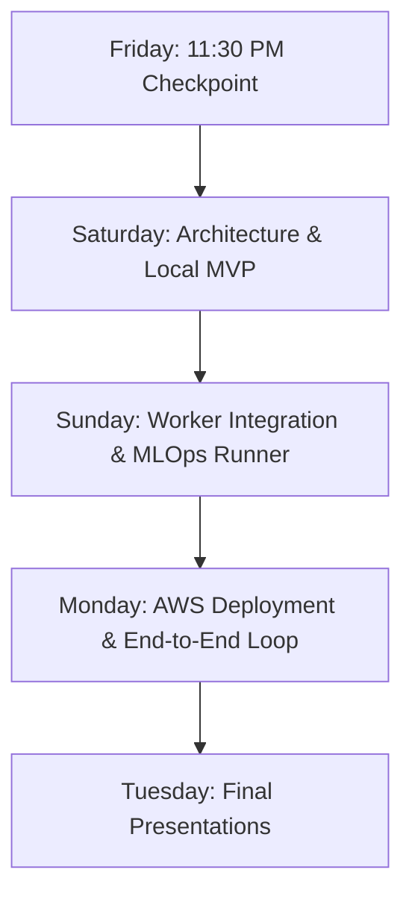

# 🖋️ Signature Detection & Verification End-to-End System
## Master Execution Plan, Architecture Specification & Jira Breakdown

---

## Executive Summary
This document defines the complete, production-grade architectural and execution roadmap for the **Signature Detection, Verification, and Automated MLOps Continuous Training Pipeline**.

The system strictly adheres to commercial open-source standards (**Apache 2.0 / MIT licensing**), replacing AGPL-licensed frameworks (e.g., Ultralytics) with **Hugging Face RT-DETR / YOLOX** for detection and a Metric Feature Extractor (**ResNet50 / ViT**) for similarity scoring. The architecture leverages AWS-native primitives (**FastAPI on ECS/Fargate, Amazon S3, Amazon SQS, and Celery/Worker**) coupled with an automated **Hugging Face Hub $\rightarrow$ Remote Training $\rightarrow$ Comet ML / MLflow $\rightarrow$ S3 Model Registry** continuous training loop.

---

## 1. 🚨 Immediate Actions & Checkpoint Protocol (Today - 11:30 PM)

| Time Window | Milestone / Action Item | Responsibility | Deliverables / Verification |
| :--- | :--- | :--- | :--- |
| **By 3:30 PM** | Form group of 4–5 members (strictly no repeat partners) | All Members | Final group roster |
| **By 4:00 PM** | Designate Group Lead (must be a first-time lead) | Lead | Lead name transmitted to Batch Reps |
| **By 7:00 PM** | Create Jira project (Scrum/Kanban) & populate Epics + Stories | Lead & Team | Full backlog populated |
| **By 9:00 PM** | Story point sizing, label assignment, and sprint allocation | Team | Sized stories with assigned owners |
| **By 11:00 PM** | Capture Jira board screenshot showing "To Do" & "In Progress" | Lead | Submission image ready for 11:30 PM Checkpoint |
| **11:30 PM** | Attend Batch Checkpoint meeting | Entire Group | Presentation of Jira board & architecture choices |

---

## 2. 📋 Comprehensive Jira Stories (Copy-Paste Ready)

### **EPIC 1: Architecture & Cloud Infrastructure (AWS Style)**

#### **Story 1.1: Production AWS Architecture Diagram**
* **Type:** Task | **Points:** 3 | **Labels:** `Architecture`, `DevOps`, `AWS`
* **Description:** Create a comprehensive, production-grade AWS architecture diagram (Draw.io / Lucidchart) illustrating:
  1. *Inference Flow:* Client $\rightarrow$ CloudFront / Route 53 $\rightarrow$ ALB $\rightarrow$ FastAPI (ECS Fargate) $\rightarrow$ S3 (image storage) + SQS (job metadata queue) $\rightarrow$ Python Worker (ECS/EC2) $\rightarrow$ DynamoDB/RDS (results) $\rightarrow$ Client Polling.
  2. *MLOps Training Loop:* Hugging Face Dataset push $\rightarrow$ Webhook $\rightarrow$ EventBridge / GitHub Actions $\rightarrow$ Remote Training (SageMaker / EC2 GPU) $\rightarrow$ Comet ML / MLflow $\rightarrow$ Model Registry (S3) $\rightarrow$ Worker zero-downtime model reload.
* **Acceptance Criteria:**
  - Exported SVG/PNG using official AWS 2024 architecture icons.
  - VPC boundaries, public/private subnets, security groups, and storage-compute separation clearly depicted.

#### **Story 1.2: AWS Cloud Resources & Security Provisioning**
* **Type:** Task | **Points:** 5 | **Labels:** `DevOps`, `Terraform/CloudFormation`, `AWS`
* **Description:** Provision AWS foundational resources:
  - S3 Buckets: `sig-raw-documents`, `sig-cropped-signatures`, `sig-model-checkpoints`.
  - SQS Queues: `sig-job-queue` (visibility timeout 120s) with Dead Letter Queue `sig-dlq` (max receive count: 3).
  - IAM Roles & Least-Privilege Policies for ECS tasks and worker services.
* **Acceptance Criteria:**
  - Buckets and queues provisioned and accessible via credentials.
  - DLQ configured and redrive policy verified.

---

### **EPIC 2: ML Pipeline - Detection & Verification (Non-Ultralytics)**

#### **Story 2.1: Apache 2.0 / MIT Signature Object Detection**
* **Type:** Story | **Points:** 8 | **Labels:** `ML`, `Inference`, `No-Ultralytics`
* **Description:** Implement signature detection using a permissively licensed framework (**Hugging Face RT-DETR**, **YOLOX**, or **Faster R-CNN**). Strictly avoid `ultralytics` (YOLOv5/v8/v11) due to AGPL-3.0 restrictions.
* **Acceptance Criteria:**
  - Model loads full document images (PNG, JPEG, converted PDF).
  - Outputs bounding boxes `[x1, y1, x2, y2]` and detection confidence scores.
  - Generates cropped, clean signature crops saved to disk / S3.
  - Verified Apache 2.0 / MIT dependency tree.

#### **Story 2.2: Signature Similarity & Verification Engine**
* **Type:** Story | **Points:** 5 | **Labels:** `ML`, `Verification`, `Embeddings`
* **Description:** Develop signature verification engine comparing detected signatures against reference signatures:
  1. Image preprocessing (stroke normalization, grayscale, background suppression, resize $224 \times 224$).
  2. Deep feature extraction using pre-trained Vision Transformer (ViT-B/16) or ResNet50 (penultimate 2048-dim representation).
  3. L2 normalization and Cosine Similarity calculation:
     $$\text{Similarity}(u, v) = \frac{\mathbf{u} \cdot \mathbf{v}}{\|\mathbf{u}\|_2 \|\mathbf{v}\|_2} \in [0.0, 1.0]$$
  4. Decision thresholding (e.g., threshold $\ge 0.80 \implies \text{Match}$).
* **Acceptance Criteria:**
  - Pipeline returns numeric score (`0.0` to `1.0`) and boolean `is_match`.
  - Evaluation on benchmark genuine vs. forged pairs yields reproducible metrics.

---

### **EPIC 3: Backend API, Message Queue & Asynchronous Worker**

#### **Story 3.1: FastAPI Asynchronous Ingestion & Job Endpoints**
* **Type:** Story | **Points:** 5 | **Labels:** `Backend`, `FastAPI`
* **Description:** Develop REST API with FastAPI:
  - `POST /v1/signatures/verify`: Receives query document and reference signature. Validates mime types, uploads binary images directly to S3, dispatches message pointer `{job_id, s3_bucket, doc_key, ref_key}` to SQS, returns `202 Accepted` with `job_id`.
  - `GET /v1/signatures/jobs/{job_id}`: Checks job status (`PENDING`, `PROCESSING`, `COMPLETED`, `FAILED`) and delivers final similarity score and detection crops.
  - `GET /health`: Health-check endpoint.
* **Acceptance Criteria:**
  - Never passes raw image binaries through SQS payloads (avoids 256KB limits).
  - OpenAPI Swagger documentation available at `/docs`.

#### **Story 3.2: Asynchronous Queue Consumer Worker Service**
* **Type:** Story | **Points:** 8 | **Labels:** `Backend`, `Worker`, `SQS`
* **Description:** Build Python background worker service:
  - Long-polls SQS queue (`WaitTimeSeconds=20`).
  - Downloads images from S3 pointers.
  - Executes `SignatureEngine`: Detection $\rightarrow$ Crop $\rightarrow$ Embedding $\rightarrow$ Cosine Similarity.
  - Persists JSON results in S3/DynamoDB and deletes processed messages from SQS.
* **Acceptance Criteria:**
  - Graceful exception handling; failing messages retry up to 3 times before routing to DLQ.
  - Non-blocking asynchronous job throughput.

---

### **EPIC 4: Automated Continuous Training (MLOps) & Model Registry**

#### **Story 4.1: Hugging Face Dataset & Automated Webhook Trigger**
* **Type:** Story | **Points:** 5 | **Labels:** `MLOps`, `HuggingFace`, `CI-CD`
* **Description:** Setup a Hugging Face Dataset repository with signature datasets (COCO/VOC format). Configure a Hugging Face Webhook or GitHub Actions workflow dispatch triggered on commit/push events.
* **Acceptance Criteria:**
  - Pushing new training samples to the HF dataset triggers the CI/CD training pipeline automatically.

#### **Story 4.2: Remote Training Runner with Comet ML / MLflow Tracking**
* **Type:** Story | **Points:** 8 | **Labels:** `MLOps`, `Experiment-Tracking`, `SageMaker`
* **Description:** Implement remote training script running on AWS SageMaker / EC2 GPU runner:
  - Loads data directly from Hugging Face Hub.
  - Trains RT-DETR / YOLOX detector.
  - Logs mAP@50, mAP@50:95, validation loss, and training curves to **Comet ML** or **MLflow**.
  - Pushes best model checkpoints to S3 model bucket (`s3://sig-model-checkpoints/`).
* **Acceptance Criteria:**
  - Experiment visible on live Comet ML / MLflow dashboard.
  - Best model artifact versioned and saved to S3.

#### **Story 4.3: Zero-Downtime Model Reload on Inference Worker**
* **Type:** Story | **Points:** 5 | **Labels:** `MLOps`, `Deployment`
* **Description:** Integrate automatic model reloading in the Worker service upon arrival of a new model version in S3, or trigger an automated ECS service update via GitHub Actions.
* **Acceptance Criteria:**
  - Worker automatically picks up new model weights without dropping active queue tasks.

---

### **EPIC 5: Integration Testing, Benchmarking & Presentation**

#### **Story 5.1: End-to-End Integration & Load Testing**
* **Type:** Task | **Points:** 3 | **Labels:** `QA`, `Testing`
* **Description:** Build end-to-end integration tests simulating document upload $\rightarrow$ SQS $\rightarrow$ Worker $\rightarrow$ Result output. Measure end-to-end latency per document.
* **Acceptance Criteria:**
  - Automated test script passes in CI environment.

#### **Story 5.2: Final Presentation Deck & Live Demo Script**
* **Type:** Task | **Points:** 2 | **Labels:** `Documentation`, `Presentation`
* **Description:** Create 10-slide presentation deck covering: Architecture, Non-Ultralytics choice rationale, SQS queue resilience, MLOps continuous training loop, and live demo fallback recording.
* **Acceptance Criteria:**
  - Deck completed and live demo rehearsed by Monday evening.

---

## 3. 🏗️ Technical Architecture Diagram (AWS Style)

```
                            +--------------------------+
                            |      Client / User       |
                            +--------------------------+
                                         |
                                         | HTTPS (Upload Document + Reference)
                                         v
                         +-------------------------------+
                         |  Application Load Balancer   |
                         +-------------------------------+
                                         |
                                         v
                   +--------------------------------------------+
                   |       FastAPI Service (AWS ECS Fargate)    |
                   +--------------------------------------------+
                           /                            \
           1. Upload Raw  /                              \ 2. Push Job Payload
              Images     /                                \   {job_id, s3_keys}
                        v                                  v
         +-----------------------------+       +-----------------------------+
         |      Amazon S3 Bucket       |       |      Amazon SQS Queue       |
         |  - /raw-documents/          |       |  (Visibility Timeout: 120s) |
         |  - /cropped-signatures/     |       +-----------------------------+
         |  - /model-checkpoints/      |                      |
         +-----------------------------+                      | 3. Long Polling
                   ^              ^                           v
                   |              |            +-----------------------------+
                   |              +----------- | Worker Service (ECS / EC2)  |
                   |      Read/Write Images    | - Hugging Face RT-DETR      |
                   |      & Save Results       | - ResNet50 Embedding Engine |
                   |                           | - Cosine Similarity Metric  |
                   |                           +-----------------------------+
                   |                                          |
                   |                                          | 4. Write Result
                   |                                          v
                   |                           +-----------------------------+
                   +-------------------------- |   DynamoDB / S3 Results     |
                                               +-----------------------------+

 =========================================================================================
                         AUTOMATED MLOps TRAINING & RELOAD LOOP
 =========================================================================================

    +--------------------------+
    |  Hugging Face Dataset    |
    |  (New images committed)  |
    +--------------------------+
                 |
                 | Webhook (push event)
                 v
    +--------------------------+
    |  GitHub Actions /        |
    |  AWS EventBridge         |
    +--------------------------+
                 |
                 | Triggers Training Job
                 v
    +--------------------------------------------------------+
    |     Remote Training Job (AWS SageMaker / EC2 GPU)      |
    +--------------------------------------------------------+
              /                                    \
             / Logs Metrics                         \ Saves Best Checkpoint
            v                                        v
  +--------------------+                   +------------------------------+
  |  Comet ML / MLflow |                   | S3 Model Registry            |
  |  (mAP, Loss, EER)  |                   | (s3://sig-model-checkpoints) |
  +--------------------+                   +------------------------------+
                                                          |
                                                          | Notifies / Reloads
                                                          v
                                           +------------------------------+
                                           |  Worker Service Model Reload |
                                           +------------------------------+
```

---

## 4. 📅 Daily Milestones & Checkpoint Schedule



| Day | Target Objective | Key Verification Checkpoints |
| :--- | :--- | :--- |
| **Friday (Tonight)** | **Board & Group Alignment** | • Group formed & Lead submitted to Batch Reps by 4 PM<br>• Jira Project live with all Epics & Stories<br>• Screenshot submitted for 11:30 PM Checkpoint |
| **Saturday** | **Local Architecture & ML MVP** | • Finalize AWS Architecture Diagram in Draw.io<br>• Setup local FastAPI + SQS (or LocalStack)<br>• Run detection inference using RT-DETR on local signatures<br>• Initialize Hugging Face Dataset repository |
| **Sunday** | **Worker Pipeline & Training Pipeline** | • Worker extracts bounding box $\rightarrow$ crops $\rightarrow$ generates embeddings $\rightarrow$ computes cosine similarity<br>• Connect training script to Comet ML / MLflow<br>• Test HF Dataset Webhook $\rightarrow$ automated training script trigger |
| **Monday (Holiday)** | **Cloud Deployment & Full Integration**| • Deploy FastAPI & Worker to AWS (ECS Fargate / EC2)<br>• Full S3 + SQS cloud queue execution<br>• Automated model rollout from S3 to inference worker<br>• Rehearse live demo & finalize slide deck |
| **Tuesday** | **Final Presentation** | • Live demonstration of inference API<br>• Live demonstration of Hugging Face automated training loop & Comet/MLflow tracking |

---

## 5. 👥 Team Resource Allocation Matrix (4–5 Members)

| Role | Title | Primary Responsibilities |
| :--- | :--- | :--- |
| **Member 1** | **Group Lead & Cloud DevOps** | • AWS Infrastructure (S3, SQS, ECS Fargate, IAM roles)<br>• Production AWS Architecture Diagram<br>• Jira management and Batch Rep coordination |
| **Member 2** | **Backend & Queue Engineer** | • FastAPI asynchronous endpoints (`POST /verify`, `GET /jobs`)<br>• S3 direct upload logic & SQS message dispatcher<br>• Result storage (DynamoDB / S3 JSON) |
| **Member 3** | **ML Inference Engineer** | • Apache 2.0 Detection (RT-DETR / YOLOX) pipeline<br>• Signature crop & preprocessing engine<br>• Deep feature embeddings & Cosine Similarity module |
| **Member 4** | **MLOps & Training Engineer** | • Hugging Face Dataset repository setup & Webhook configuration<br>• Remote training script & hyperparameters<br>• Comet ML / MLflow metric & artifact logging |
| **Member 5** | **Integration & Demo Lead** *(if 5 members)* | • End-to-end integration tests & benchmarking<br>• Test client / Streamlit evaluation UI<br>• Presentation slide deck & fallback video demo |

---

## 6. ⚖️ Architectural Guardrails & Compliance Checklist

1. **Strictly No Ultralytics:** Verify that `requirements.txt` and `pyproject.toml` contain zero references to `ultralytics`, `yolov5`, or `yolov8`. Use `transformers` (RT-DETR) or `yolox` (Apache 2.0).
2. **Decoupled Queue Payloads:** Never pass base64 image data inside SQS messages (256KB hard limit). SQS messages must strictly contain S3 URI pointers and job metadata.
3. **Queue Visibility Timeouts:** Set SQS visibility timeout to at least **120 seconds** (greater than the maximum model inference time) to prevent duplicate processing.
4. **Dead Letter Queue (DLQ):** Configure DLQ with `maxReceiveCount = 3` to catch malformed documents without blocking the queue.
5. **Calibrated Verification Metric:** Cosine similarity must be normalized to $[0.0, 1.0]$ with an explicit threshold (e.g., $0.80$) determining authentic vs. forged classification.

---

## 7. 📦 Local Dataset Context & Ready-to-Use Artifacts

A curated and merged dataset is already present in your local environment:
* **Directory:** [`merged_signature_dataset/`](file:///e:/sign_detect-verify/merged_signature_dataset)
* **Total Cleaned Images:** 28,958 images across `train` (22,953), `valid` (3,287), and `test` (2,718).
* **Annotations:** YOLO format (`cx cy w h`, normalized) with 1 class (`0: signature`).
* **Hugging Face Hub Integration:** This dataset can be pushed directly to your Hugging Face Dataset repository using `datasets` or `huggingface_hub` as the foundation for the automated continuous training trigger (Epic 4).

## 8. 🎯 Technical FAQ: Why YOLOX vs. YOLO Family & Model Sizing Analysis

### Q: Why YOLOX instead of other YOLO models (YOLOv5, YOLOv8, YOLOv9, YOLOv10, YOLOv11)?
The primary filter is **commercial license legality**:

| Model | Author / Organization | License | Can We Use It? |
| :--- | :--- | :--- | :--- |
| **YOLOv5, YOLOv8, YOLOv11** | Ultralytics | **AGPL-3.0** | ❌ **STRICTLY FORBIDDEN by Instructor** (forces entire proprietary codebase to be open-sourced if deployed over network). |
| **YOLOv6** | Meituan | **GPL-3.0** | ❌ Strong copyleft license, problematic for backend services. |
| **YOLOv7** | WongKinYiu | **GPL-3.0** | ❌ GPL copyleft license. |
| **YOLOv9, YOLOv10** | Academic authors | **GPL-3.0 / AGPL-3.0** | ❌ Copyleft license. |
| **YOLOX** | Megvii | **Apache 2.0** | ✅ **100% Permissive Commercial License.** |
| **RT-DETR** | Baidu / Hugging Face | **Apache 2.0** | ✅ **100% Permissive Commercial License.** |

### Q: Is YOLOX too large for our 29k–50k image signature dataset?
**No, because YOLOX is a model *family*, not just one giant model!** The "X" in YOLOX does *not* stand for "Extra-Large"; it stands for "Exceeding YOLO series in 2021" (anchor-free architecture).

YOLOX provides multiple sizes tailored for different dataset volumes and inference speeds:
* **YOLOX-Nano:** ~0.91M parameters (ultra-lightweight, edge/CPU).
* **YOLOX-Tiny:** ~5.06M parameters (fast CPU/low-resource GPU).
* **YOLOX-S (Small - Recommended):** ~8.96M parameters — **Ideal for our ~29k image dataset**. It converges quickly, avoids overfitting, and delivers ~50+ FPS on inference.
* **YOLOX-M (Medium):** ~25.3M parameters.
* **YOLOX-L / YOLOX-X:** 54M–99M parameters (only needed for complex 80-class COCO, overkill for 1-class signature detection).

**Recommendation for your team:** Use **YOLOX-S** or **YOLOX-Tiny**. With only 1 class (`signature`), YOLOX-S trains in just a few hours on a modest GPU and produces high mAP without overfitting.


