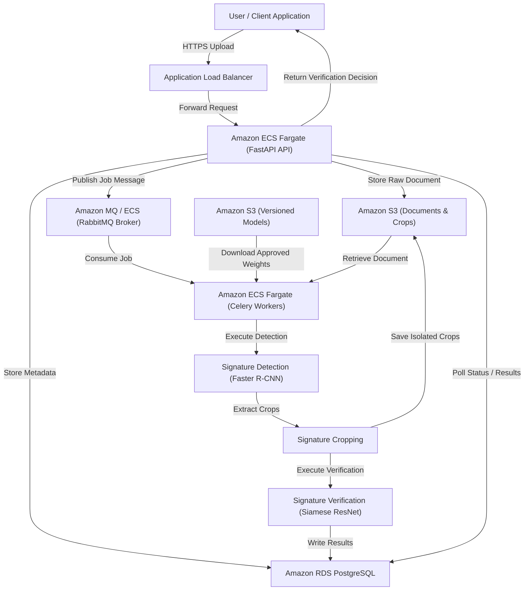
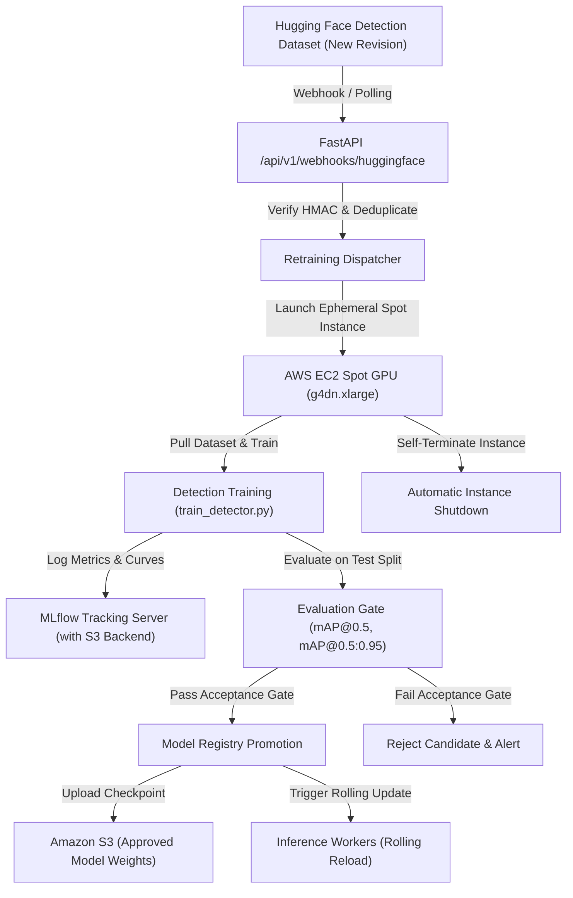

# AWS Architecture & Financial Risk Management

**Document Version:** 1.0.0  
**Date:** November 2026  
**Project:** Signature Detection & Verification Platform  

---

## 1. System Architecture Overview

The platform uses an asynchronous, event-driven microservices architecture deployed on Amazon Web Services (AWS):

---

## 2. Detection MLOps Retraining Flow

---

## 3. Comprehensive AWS Cost Risk Analysis

| AWS Service | Deployment Tier | Estimated Monthly Cost | Financial Risk Level | Mitigation Strategy |
| :--- | :--- | :--- | :--- | :--- |
| **EC2 GPU Training (g4dn.xlarge)** | Retraining (Spot) | ~$0.526/hour (~$5 - $15 / run) | **HIGH (if left running)** | **Never use persistent GPU instances.** Use transient EC2 Spot instances or Google Colab with script auto-shutdown (`sudo shutdown -h now`). |
| **NAT Gateway** | VPC Networking | ~$32.40/month + $0.045/GB transfer | **HIGH (Common silent cost)** | Run development ECS tasks in public subnets with Internet Gateway and security groups. Deploy a single NAT Gateway only in final staging. |
| **Amazon MQ (RabbitMQ)** | Message Broker | ~$25 - $35/month (`mq.t3.micro`) | **MEDIUM** | Use single-AZ `mq.t3.micro` for staging, or run RabbitMQ as an ECS container task during development. |
| **Amazon RDS (PostgreSQL)** | Database | ~$15 - $25/month (`db.t4g.micro`) | **MEDIUM** | Enable auto-stop when not actively testing; use 20GB gp3 storage. |
| **Amazon ECS Fargate** | Compute (API + Workers) | ~$15 - $30/month (0.5 vCPU, 1 GB RAM) | **LOW - MEDIUM** | Use Fargate Spot (saves up to 70%); configure scaling to 0 tasks during idle hours. |
| **Amazon S3** | Object Storage | < $2.00/month | **VERY LOW** | Configure 14-day expiration lifecycle rules on test upload buckets. |
| **Amazon CloudWatch** | Monitoring & Logs | < $5.00/month | **LOW** | Set 7-day log retention policies to avoid log accumulation charges. |

**Total Estimated Deployment Running Cost:** ~$60 – $105/month during active testing (reducible to ~$15/month when idle or run via Docker on a single t3/t4g EC2 instance).
